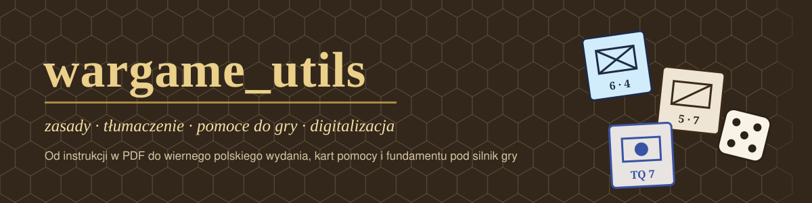
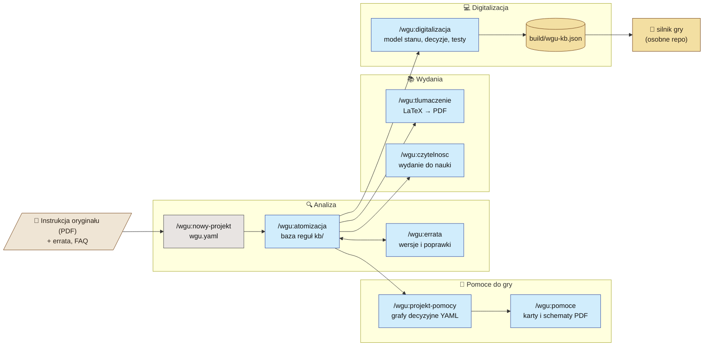
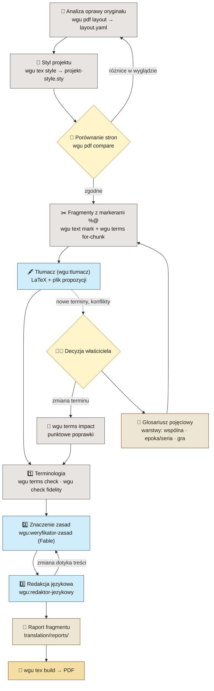
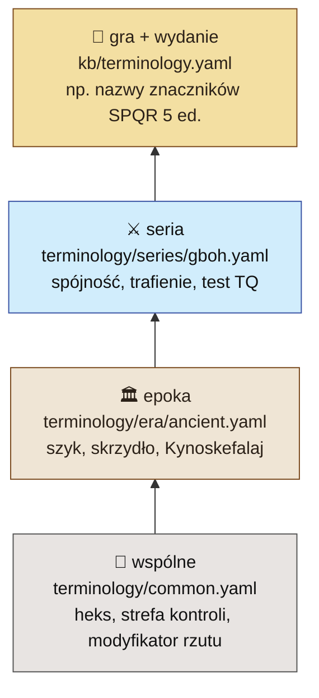
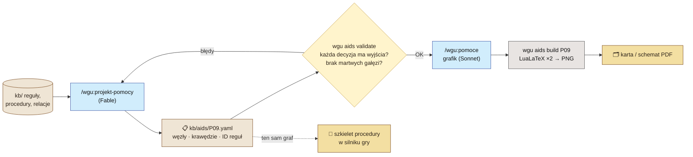

<p align="center">
  
</p>

<p align="center">
  
  
  
  
</p>

**wargame_utils** to warsztat do pracy z instrukcjami historycznych gier wojennych: od PDF-u wydawcy do wiernego
polskiego wydania w oprawie oryginału, kart i schematów pomocy oraz bazy wiedzy, na której można zbudować
komputerową wersję gry. Narzędzie składa się z dwóch części:

| | Co to jest | Kto pracuje |
|---|---|---|
| 🧩 **Plugin Claude Code `wgu`** | skille `/wgu:*` i wyspecjalizowani agenci (analityk zasad, tłumacz, weryfikator zasad, redaktor językowy, projektant pomocy, grafik, architekt digitalizacji) | modele językowe, każdy dobrany do zadania |
| 🛠️ **CLI `wgu` (Python)** | wszystko, co da się zrobić bez modelu: ekstrakcja i pomiar PDF, kontrola glosariusza i wierności, kompilacja LaTeX, walidacja, eksport | skrypty, deterministycznie i tanio |

> [!IMPORTANT]
> Tłumaczenia i pomoce tworzone tym narzędziem są **nieoficjalne**. Nie publikuj materiałów wydawców bez ich zgody
> i nie używaj ich znaków towarowych w sposób sugerujący oficjalne wydanie.

---

## 🗺️ Mapa całości



**Zasada:** baza wiedzy `kb/` (YAML) jest jedynym źródłem prawdy o zasadach. Tłumaczenie, pomoce i digitalizacja
korzystają z niej zamiast czytać PDF od nowa.

---

## 🚀 Szybki start

**1. Instalacja narzędzia** (raz, na komputerze)
```bash
git clone git@github.com:yautay/wargame-utils.git C:/dev/wargame_utils
```
```bash
pip install -r C:/dev/wargame_utils/requirements.txt
```
Potrzebny też **LuaLaTeX** (MiKTeX lub TeX Live). Pułapki środowiska: [templates/docs/pulapki.md](templates/docs/pulapki.md).

**2. Katalog gry** (osobne repo albo `games/<id>` w monorepo, początkowo z PDF-em instrukcji)
```text
mojagra/
├── docs/rules.pdf
└── .claude/settings.json      ← włącza plugin wgu (przykład niżej)
```
```json
{
  "extraKnownMarketplaces": {
    "wargame-utils": { "source": { "source": "directory", "path": "C:/dev/wargame_utils" } }
  },
  "enabledPlugins": { "wgu@wargame-utils": true }
}
```
Albo z terminala:
```bash
claude plugin marketplace add C:/dev/wargame_utils --scope project
```
```bash
claude plugin install wgu@wargame-utils --scope project
```

**3. Pierwsza sesja Claude Code w repozytorium gry**
```text
/wgu:nowy-projekt          → wgu.yaml, rozpoznanie źródeł, kolor zmian wersji, fonty
/wgu:atomizacja            → baza reguł kb/ (najdłuższy krok, model Fable)
/wgu:tlumaczenie --proba   → próba na 5 fragmentach, zanim ruszy całość
```

---

## 🖋️ Tłumaczenie: jak to działa

Tłumaczenie jest najważniejszą funkcją narzędzia. Celem jest przekład, który czyta się jak dobrze napisaną polską
instrukcję, a w którym **każdy przepis znaczy dokładnie to samo co w oryginale**. Płynność, która zmienia warunek,
obowiązek albo wyjątek, jest błędem.



### Trzy przebiegi weryfikacji, trzech różnych wykonawców

| Przebieg | Sprawdza | Kto | Nie sprawdza |
|---|---|---|---|
| **1. Terminologia** | odrzucone i nieaktualne formy, terminy sporne, liczby, odsyłacze, sygnały modalności (`może`/`musi`/`nie wolno`), zakres i przeczenia | skrypty `wgu terms check`, `wgu check fidelity` | znaczenia ani stylu |
| **2. Znaczenie zasad** | modalność, negacja, alternatywy, zakres wyjątków, kolejność, limity i ich odniesienie, granice (≥ / >) | agent `wgu:weryfikator-zasad` (Fable) | stylu |
| **3. Redakcja językowa** | kalki, neologizmy, szyk, typografia, zbędne glosy | agent `wgu:redaktor-jezykowy` | terminów zatwierdzonych |

> [!NOTE]
> W próbie na SPQR ([docs/proby](docs/proby/2026-10-04-spqr-tlumaczenie.md)) skrypt wykrył 5 z 6 wstrzykniętych
> błędów znaczenia, bez fałszywych alarmów. Ślepy weryfikator wykrył 6 z 6, łącznie z subtelną zmianą progu
> „osiągnie lub przekroczy” → „przekroczy”. Obecność terminów z glosariusza **nie** dowodzi poprawności przekładu.

### Glosariusz: pojęcie w kontekście, nie słowo



Warstwa bardziej szczegółowa wygrywa, a nadpisanie musi być jawne (`overrides`). Jedno angielskie słowo może mieć
kilka pojęć (*line* jako grupa jednostek ≠ *Line Command*). Dwie różne mechaniki nigdy nie dzielą odpowiednika
(*rout* ≠ *withdrawal* ≠ *retreat*). Przykładowy rekord:

```yaml
- id: gboh.tq-check
  source_term: TQ Check
  sense: Rzut kością porównywany z wartością TQ; wynik wyższy od wartości daje trafienia.
  disambiguation: Test, nie parametr (zob. gboh.tq-rating).
  pl: test TQ
  pl_forms: [test TQ, testu TQ, teście TQ, testem TQ, testy TQ, testów TQ]
  rejected: [{pl: rzut na TQ, reason: wariant PL3; jedno pojęcie = jeden termin}]
  status: proposal          # proposal → approved (tylko decyzja właściciela) / disputed / deprecated
  evidence:
    - {source: GMT-SPQR-PL3, where: s. 15, form: test TQ, supports: usage-in-games}
```

`supports` mówi, **co** potwierdza dowód. To, że słowo istnieje w słowniku (`existence`), nie znaczy, że jest
właściwym odpowiednikiem mechaniki. Przykład: *harcownik* w WSJP to uczestnik pojedynku przed bitwą, a nie *skirmisher*.
Źródła i ich ocena: [skills/tlumaczenie/references/zrodla.md](skills/tlumaczenie/references/zrodla.md).

### Oprawa jak w oryginale

Każda instrukcja dostaje własny styl wygenerowany z pomiaru jej PDF-u: format, kolumny, fonty (wolne zamienniki),
nagłówki, numery reguł, ramki uwag z kolorami, paginy. Tekst przekładu używa tylko makr wspólnego API
(`wgu-base.sty`: `\regula`, `\wyjatek`, `uwagahist`, `uwagaprojektanta`, `przyklad`…), więc zmiana oprawy nie wymaga
zmian w tekście.

```text
wgu pdf layout oryginal.pdf translation/layout.yaml --pages 6-40     # pomiar → szkic specyfikacji
wgu tex style translation/layout.yaml spqr-style.sty                 # styl projektu + wgu-base.sty
wgu tex build test.tex                                                # kompilacja, raport błędów, PNG
wgu pdf compare oryginal.pdf 14 test.pdf 1 porownanie.png             # strony obok siebie
```

---

## 🧭 Pomoce do gry



---

## 📦 Skille

| Skill | Co robi | Model |
|---|---|---|
| `/wgu:nowy-projekt` | zakłada `wgu.yaml`, rozpoznaje źródła i oprawę | — |
| `/wgu:atomizacja` | baza reguł: reguły z cytatami, definicje, tabele, procedury, relacje, niejasności, scenariusze | Fable |
| `/wgu:errata` | porównanie wersji, errata, FAQ, rozstrzygnięcia, poprawki tłumaczenia | Fable / redaktor |
| `/wgu:tlumaczenie` | tłumaczenie LaTeX → PDF z glosariuszem, oprawą oryginału i trzema przebiegami weryfikacji | tłumacz + Fable + redaktor |
| `/wgu:czytelnosc` | wydanie do nauki z kontrolą wierności | redaktor |
| `/wgu:projekt-pomocy` | specyfikacje pomocy (grafy decyzyjne) | Fable |
| `/wgu:pomoce` | karty i schematy w TikZ | Sonnet |
| `/wgu:digitalizacja` | model stanu, decyzje, losowość, modyfikatory, testy given/when/then, pakiet JSON | Fable |
| `/wgu:regula` | szybkie wyszukanie reguły lub terminu w bazie | Haiku |

## ⌨️ CLI

```text
wgu init [--setup --pdf F --image F… --no-git --no-plugin] | config
wgu workspace list | check [--strict]
wgu -C GAME config                         # wybór gry z workspace
wgu pdf    analyze | extract | images | render | layout | compare
wgu kb     import-legacy | lint | render | show ID… | stats | export
wgu terms  lint | show | check TEX… | impact ID --tex … --src … | for-chunk SRC | glossary-tex OUT | import-md
wgu text   mark SRC OUT                   # markery %@ przed numerami reguł
wgu check  fidelity SRC TEX…              # liczby, odsyłacze, modalność, przeczenia, zakres, terminy
wgu aids   validate [ID…] | build ID…
wgu tex    build FILE [--render DPI] | style LAYOUT.yaml OUT.sty
```
Bez instalacji: `python C:/dev/wargame_utils/wgu.py …`. Po `pip install -e .` wystarczy `wgu …`.

## 🔌 BGG: planowany serwer MCP

<p align="center">
  <a href="https://boardgamegeek.com/">
    
  </a>
</p>

Serwer MCP do BoardGameGeek jest częścią WGU w **tym repozytorium**. Pierwsza wersja działa lokalnie
przez stdio. Dane poszczególnych gier nadal należą do repozytoriów gier.

### Uruchomienie MCP

AI szukające klaryfikacji musi stosować [protokół korzystania z MCP BGG](docs/BGG-MCP-WORKFLOW.md):
najpierw lokalne źródła i MCP, bez zbędnego przeglądania witryny BGG, z budżetem i oceną dowodów.

Zainstaluj zależności przez `pip install -r requirements.txt`. Ustaw `BGG_API_TOKEN` w środowisku procesu
uruchamiającego MCP (po zmianie zmiennych systemowych może być potrzebne ponowne uruchomienie klienta).
Token nie jest odczytywany z repozytorium ani wypisywany przez narzędzia.

```bash
python -m wgu.bgg_mcp
# albo po instalacji WGU:
wgu mcp
```

Przykład konfiguracji klienta MCP (token dziedziczony ze środowiska, ścieżki dostosuj do instalacji):

```json
{
  "mcpServers": {
    "wgu-bgg": {
      "command": "F:/repo/wargame-utils/.venv/Scripts/python.exe",
      "args": ["-m", "wgu.bgg_mcp"],
      "cwd": "F:/repo/wargame-utils"
    }
  }
}
```

Narzędzia: `bgg_search_games`, `bgg_forums`, `bgg_find_clarifications`, `bgg_search_posts`, `bgg_threads`, `bgg_thread`, `bgg_verify_authority`.
Najpierw znajdź grę i jej forum Rules, potem szukaj oryginalnych terminów w tytułach i pobierz wybrane
wątki. `bgg_find_clarifications` przeszukuje tytuły, do 3 stron po 50 wątków na wywołanie.
`bgg_search_posts` szuka frazy w **treści wpisów**, również przy niepasującym tytule. Dopasowanie ignoruje
wielkość liter, normalizuje odstępy i odczytuje tekst HTML tylko do wyszukania; zwracana treść pozostaje oryginalna.
Jedno wywołanie sprawdza fragment jednej strony forum, maksymalnie 5 partii po 100 wpisów
(`max_batches`: 1–5), plus listę forów gry i stronę listy wątków. Każde pobranie używa wspólnego
cache i ogranicznika zapytań; limit 3 prób HTTP nadal obowiązuje. To ograniczenia WGU, nie gwarantowany limit BGG.
Wynik zawiera `visited`, liczbę sprawdzonych wpisów, powód zatrzymania oraz `next_cursor`.
Kontynuuj ręcznie parametrami kursora, zachowując tę samą grę, forum i frazę. Lista wątków jest zmienna:
przesunięcia po aktualizacjach mogą powodować powtórzenia lub pominięcia. Błąd BGG zatrzymuje pobieranie
i zwraca dotychczasowe trafienia; nie należy automatycznie kontynuować po błędzie.
Brak trafień w sprawdzonym fragmencie nie oznacza braku klaryfikacji na całym forum.
Pobranie wpisów przez `bgg_thread` jest ograniczone do 100 na wywołanie z kontynuacją po ID.
Autorstwo i daty pochodzą z BGG. Weryfikacja roli korzysta z lokalnego rejestru dowodów
`BGG_AUTHORITY_FILE`: powiązanie konta z konkretną grą musi zatwierdzić operator na podstawie źródeł.
Wyniki wyszukiwania wpisów automatycznie zawierają ocenę roli i osobną ocenę oficjalności wypowiedzi.
Brak dowodu pozostawia `unverified`, a sama potwierdzona rola nie nadaje wpisowi statusu oficjalnej klaryfikacji.
Konfiguracja, wymagane dowody i format rejestru: [weryfikacja autorstwa BGG](docs/BGG-AUTHORITY.md).

Cache oryginalnych odpowiedzi XML jest ważny godzinę i znajduje się w `~/.cache/wgu/bgg`
(można zmienić przez `BGG_CACHE_DIR`). Każdy proces wykonuje najwyżej jedno zapytanie co 5 sekund,
z maksymalnie 3 próbami dla przejściowych błędów HTTP. Uruchamiaj jedną instancję dla tokenu — limit
nie jest współdzielony między procesami. Błędy autoryzacji i przekierowania zatrzymują zapytanie.
Przed przekazaniem treści zewnętrznemu klientowi LLM uwzględnij jego politykę używania danych;
danych BGG nie wolno używać do treningu.

**Główny cel MCP: znajdowanie klaryfikacji zasad konkretnej gry**, przede wszystkim odpowiedzi autorów
i wydawców oraz wyjaśnień i dyskusji graczy. Ma wspierać rozstrzyganie niejasności podczas atomizacji,
tłumaczenia, weryfikacji zasad i pracy z erratą.

Planowany przebieg:

1. Ustalenie gry, jej identyfikatora BGG oraz wydania i wersji instrukcji, której dotyczy pytanie.
2. Odnalezienie forum zasad gry, wybór wątków pasujących do pytania, terminu lub numeru reguły
   i pobranie dyskusji wraz z kontekstem odpowiedzi.
3. Zwrócenie źródeł: linku do konkretnego wpisu, autora, daty, istotnego fragmentu i kontekstu wydania.
   Status autora/projektanta lub przedstawiciela wydawcy wymaga potwierdzenia dla danej gry;
   sama nazwa konta ani ogólne oznaczenie „Designer” nie wystarczają.
4. Rozróżnienie oficjalnej erraty/FAQ, potwierdzonej odpowiedzi autora lub wydawcy, interpretacji gracza
   i reguły domowej. Sprzeczne odpowiedzi i brak rozstrzygnięcia mają być jawnie wskazane;
   popularność wpisu nie nadaje mu oficjalnego statusu.
5. Przygotowanie materiału do oceny i powiązania z regułami w `kb/`, z zachowaniem pochodzenia źródeł.
   Znalezienie wypowiedzi nie oznacza automatycznej zmiany zasad w bazie wiedzy.

[BGG XML API2](https://boardgamegeek.com/wiki/page/BGG_XML_API2) udostępnia listę forów gry (`forumlist`),
listy wątków (`forum`) i wpisy wątku (`thread`). Endpoint `search` wyszukuje po nazwach obiektów,
nie w treści dyskusji. Wyszukiwanie klaryfikacji będzie więc wymagało selekcji wątków i przeszukiwania
pobranych treści, z jawnym zakresem przeszukania — brak trafienia nie dowodzi braku odpowiedzi na BGG.
Pobieranie będzie ograniczone do potrzeb pytania, z cache, ograniczeniem częstotliwości i obsługą ponowień.

Metadane gier i wydań służą identyfikacji właściwych źródeł. Statystyki i kolekcje użytkowników
są zakresem dodatkowym, po obsłudze klaryfikacji zasad.

### Dostęp i wymagania BGG

Punktem wyjścia jest wskazana w mailu zatwierdzającym
[instrukcja Using the XML API](https://boardgamegeek.com/using_the_xml_api), wraz z powiązanymi
[XML API Terms of Use](https://boardgamegeek.com/xmlapi/termsofuse) i
[dokumentacją XML API2](https://boardgamegeek.com/wiki/page/BGG_XML_API2).
Przed implementacją i wydaniem należy ponownie sprawdzić aktualne zasady oraz zakres zgłoszonej aplikacji.

- **Wierność danych:** warunki zabraniają modyfikowania danych pobranych przez API, w tym wpisów
  użytkowników. Zachowujemy oryginalną treść i pochodzenie; własne adnotacje i oceny źródeł muszą być
  wyraźnie oddzielone. Nie przedstawiamy parafrazy ani tłumaczenia jako oryginalnej wypowiedzi.
- **AI/LLM:** zabronione jest używanie danych BGG do trenowania systemów AI lub LLM. Nie tworzymy z nich
  zbiorów treningowych. Zakazu treningu nie utożsamiamy z zakazem każdego użycia przy odpowiadaniu,
  ale samo zatwierdzenie aplikacji nie rozstrzyga wszystkich kwestii MCP, streszczeń i materiałów
  pochodnych — ich dopuszczalność trzeba ocenić względem pełnych warunków i faktycznego zgłoszenia.
- **Źródło i obciążenie:** wyniki muszą wskazywać BoardGameGeek jako źródło. Pobieramy tylko potrzebne
  dane przez udokumentowane XML API, korzystamy z cache i ograniczonej liczby ponowień; nie obchodzimy
  blokad ani ograniczeń i nie budujemy masowego archiwum forum.
- **Zgoda:** 16 października 2026 BGG zatwierdziło zgłoszoną aplikację niekomercyjną. Zgoda dotyczy tej
  aplikacji; nie oznacza automatycznego zatwierdzenia innych aplikacji korzystających z kodu WGU.
- **Token:** po zatwierdzeniu należy wygenerować token w
  [Applications → Tokens](https://boardgamegeek.com/applications). Konfiguracja WGU używa zmiennej
  środowiskowej `BGG_API_TOKEN`. Token przechowuj poza repozytorium; nie dodawaj go do kodu, przykładów,
  logów ani plików konfiguracji gier. Żądania HTTPS wymagają nagłówka `Authorization: Bearer <token>`.
- **Zakres użycia:** planujemy lokalny MCP na potrzeby zatwierdzonej aplikacji. BGG zabrania usług
  pośredniczących udostępniających dane innym aplikacjom. Publiczny serwer MCP dla innych aplikacji wymaga
  osobnego uzgodnienia z BGG; każda odrębna aplikacja używająca biblioteki powinna mieć własny token.
- **Oznaczenie:** publiczna aplikacja musi wyświetlać czytelne logo **„Powered by BGG”** z odnośnikiem do
  BoardGameGeek. Sam tekst w README nie zastępuje logo w aplikacji. Oficjalne pliki logo są wskazane
  w [instrukcji używania XML API](https://boardgamegeek.com/using_the_xml_api).
- **Opłaty i wsparcie:** według otrzymanego zatwierdzenia aplikacja niekomercyjna obecnie nie podlega
  opłatom. BGG nie zapewnia wsparcia technicznego XML API; zasady i limity mogą się zmieniać.

Implementację i użycie integracji należy opierać na aktualnych
[zasadach BGG XML API](https://boardgamegeek.com/using_the_xml_api), z minimalizowaniem liczby zapytań
i bez korzystania z prywatnych endpointów serwisu.

## 📁 Repozytorium gry po pełnym przebiegu

```text
mojagra/
├── wgu.yaml                  konfiguracja projektu
├── docs/rules.pdf            oryginał
├── kb/                       baza wiedzy (YAML, źródło prawdy)
│   ├── rules/*.yaml          atomowe reguły z cytatami
│   ├── terminology.yaml      glosariusz warstwy gry
│   ├── aids/*.yaml           specyfikacje pomocy
│   └── digital/*.yaml        fundament digitalizacji
├── translation/              fragmenty, propozycje, decyzje, raporty, layout.yaml
├── tex/ + <gra>-style.sty    tłumaczenie LaTeX (+ wgu-base.sty)
├── pomoce/                   karty i schematy (TikZ → PDF)
└── build/wgu-kb.json         pakiet dla projektu digitalizacji
```

## 📚 Dokumentacja

- [Architektura](docs/ARCHITECTURE.md) · [Modele i koszty](docs/MODELE.md) · [Digitalizacja](docs/DIGITALIZACJA.md)
- Tłumaczenie: [polityka terminologiczna](skills/tlumaczenie/references/polityka-terminologiczna.md) ·
  [styl przepisów](skills/tlumaczenie/references/styl-przepisow.md) ·
  [wierność zasad](skills/tlumaczenie/references/wiernosc-zasad.md) ·
  [weryfikacja](skills/tlumaczenie/references/weryfikacja.md) · [źródła](skills/tlumaczenie/references/zrodla.md)
- Próby: [SPQR, 2026-10-04](docs/proby/2026-10-04-spqr-tlumaczenie.md)

## 🧪 Testy

```bash
python -m pytest tests
```
